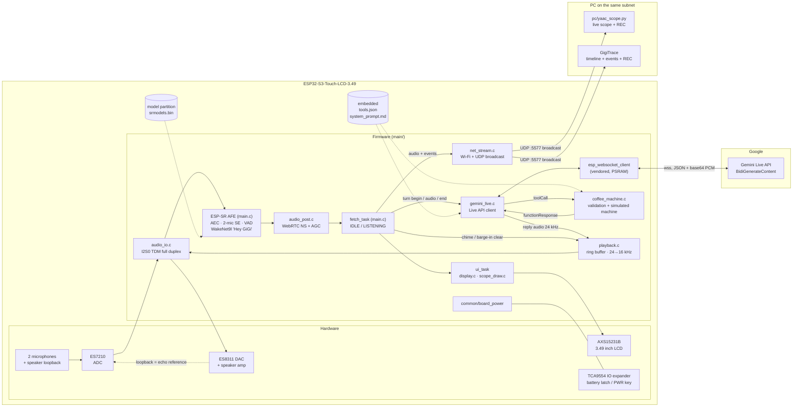
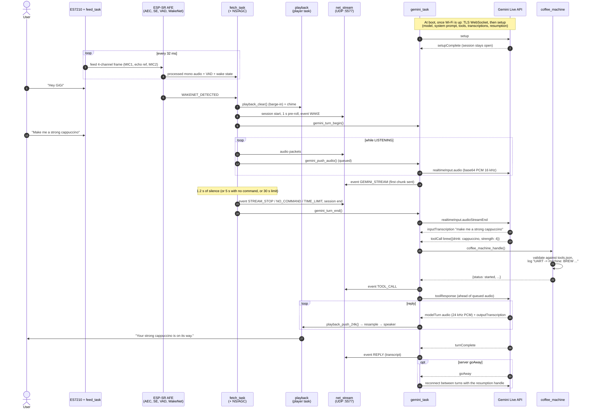

# YAAC — Yet Another Alexa Clone (ESP32-S3-Touch-LCD-3.49)

Voice assistant for a coffee machine, running on the Waveshare ESP32-S3-Touch-LCD-3.49:

- **"Hey GiGi"** wake word, detected **offline** on the board (Espressif **ESP-SR** 2.5.5, WakeNet9l).
- The command that follows is streamed to **Gemini Live** (`gemini-2.5-flash-native-audio-preview-09-2025`)
  over a TLS WebSocket; the spoken reply plays on the board's speaker.
- Gemini drives a **simulated Philips coffee machine** through function calls (`brew`, `stop`,
  `save_drink_settings`, `start_maintenance`, ...), validated on the device against `tools.json`.
- The processed microphone audio and the assistant's events are broadcast over **UDP** for the
  PC viewers (`pc/yaac_scope.py`, `../GigiTrace`).

Prompt and functions are shared with the Python prototype in `voice-coffee-assistant-poc-main/`
(see its README to try the same assistant from a laptop microphone).

## Components

Rendered copies of both diagrams: [`docs/components.svg`](docs/components.svg),
[`docs/sequence_voice_turn.svg`](docs/sequence_voice_turn.svg) (regenerate them after editing the
Mermaid source below, e.g. `npx @mermaid-js/mermaid-cli -i diagram.mmd -o diagram.svg`).



| Module | Role |
|---|---|
| `main/main.c` | Bring-up, ESP-SR AFE setup, the audio tasks (`feed`, `fetch`), the listening state machine, chime, UI and heartbeat tasks |
| `main/audio_io.c` | I2S0 in TDM full duplex (4 × 16-bit slots, 16 kHz), ES7210 + ES8311 through `esp_codec_dev`, speaker amp |
| `main/audio_post.c` | WebRTC noise suppression + AGC on the AFE output (10 ms frames) |
| `main/net_stream.c` | Wi-Fi station (auto-reconnect), UDP broadcast of audio and event packets |
| `main/gemini_live.c` | Always-open Gemini Live session: setup, uplink audio, transcripts, reply audio, tool calls, resumption |
| `main/coffee_machine.c` | C port of the prototype's `validate()` + `FakeMachine`; levels → ml / s / °C; logs the UART frames |
| `main/playback.c` | One writer to the speaker: 20 s PSRAM ring, player task, 24 → 16 kHz FIR resampler |
| `main/display.c`, `main/scope_draw.c` | 640×172 landscape panel, text and oscilloscope drawing |
| `../common/board_power` | Holds battery power on at boot; long press on PWR (1.5 s) turns off |
| `components/esp_websocket_client` | Vendored 1.8.0 with task stack and buffers in PSRAM (`VENDORED.md`) |
| `models/wn9l_heygigi` | WakeNet9l "Hey GiGi" model, packed into `srmodels.bin` |
| `pc/yaac_scope.py` | Live oscilloscope of the UDP audio, REC to WAV |
| `../GigiTrace` | Rewindable timeline of audio + events (wake word, streaming, tool calls, replies) |

## Sequence: one voice turn



The speaker output is looped back into the ES7210 as the echo reference, so the AFE cancels
the chime and Gemini's voice from the microphones: they do not re-trigger the wake word, and you
can say "Hey GiGi" over a reply to interrupt it.

## Audio pipeline
```
ES7210 TDM slots:  0 MIC1 | 1 speaker echo reference | 2 MIC2 | 3 unused     -> AFE input "MRMN"
ESP-SR AFE (AFE_TYPE_SR, HIGH_PERF, output gain x2):
    AEC  - acoustic echo cancellation against the reference
    SE   - 2-mic speech enhancement (beamforming)
    VAD  - voice activity detection
    WakeNet9l "Hey GiGi" (wn9l_heygigi)
After the AFE (audio_post.c, does not affect the wake word):
    NS   - WebRTC noise suppression, medium
    AGC  - WebRTC adaptive digital, target -3 dBFS, up to 15 dB boost
-> screen trace, UDP stream, Gemini uplink
```
- With WakeNet active, the AFE refuses its own NS/AGC, hence the separate post stage.
- I2S0 runs full duplex in TDM for both codecs; they share BCLK/WS, so playback also writes
  4-slot frames (`audio_play()` fills every slot).
- Tuning knobs are the `#define`s at the top of `main/main.c` (`AFE_OUTPUT_GAIN`, `POST_NS_MODE`,
  `POST_AGC`, `AGC_*`) and `MIC_GAIN_DB` / `SPK_VOLUME` in `main/audio_io.c`.

## Listening turn
| Rule | Value (`main/main.c`) |
|---|---|
| Wait for the command to start after the wake word | `LISTEN_START_MS` 5 s |
| Speech within this time of detection is the wake word's own tail | `WAKE_TAIL_MS` 0.5 s |
| End of command: silence | `LISTEN_SILENCE_MS` 1.2 s |
| Hard limit | `LISTEN_TIMEOUT_MS` 30 s |

Only audio after the wake word goes to Gemini; the UDP stream also carries up to 1 s of
pre-roll so the wake word itself is visible.

## Gemini Live
- Raw protocol over `wss://generativelanguage.googleapis.com/ws/...BidiGenerateContent`: JSON
  messages, uplink 16 kHz PCM in base64 32 ms chunks, reply audio 24 kHz PCM.
- **Always-open session**: connects as soon as Wi-Fi is up, reconnects with backoff (1 → 30 s),
  reconnects between turns on `goAway`. `sessionResumption` keeps the conversation across
  reconnects; `contextWindowCompression` (sliding window) keeps long sessions alive.
  Audio from a turn that starts while (re)connecting is held (~5 s queue) until `setupComplete`.
- Input and output transcriptions are logged (`USER:` / `GEMINI:`); `interrupted` from the server
  flushes the speaker.
- `voice-coffee-assistant-poc-main/tools.json` and `system_prompt.md` are embedded in the firmware
  at build time (single source with the Python prototype). `x-*` / `_*` keys are stripped before
  sending; `x-range` is enforced by `coffee_machine.c` only.
- Tool responses are sent ahead of queued audio. The machine is simulated: commands appear in the
  log as `[UART -> machine] BREW cappuccino aroma=4 coffee=40ml milk=5s temp=90C ...`.

## Network stream (UDP)
- Broadcast to the board's subnet (e.g. `192.168.0.255` for a /24), **port 5577**. Routers do not
  forward it; the PC must be on the same subnet. Allow Python through the Windows firewall on
  **private** networks.
- Packet (little endian, `main/net_stream.h`): 20-byte header `"YAAC"`, u8 version (1),
  u8 flags (1 start, 2 end, 4 event), u16 n, u32 session, u32 seq, u32 sample rate, then
  - audio: `n` int16 samples (up to 512 = 32 ms)
  - event: `n` bytes = u8 type + UTF-8 text

| Event | Type | Sent when |
|---|---|---|
| `NET_EV_WAKE` | 1 | wake word detected |
| `NET_EV_GEMINI_STREAM` | 2 | the turn's first audio chunk goes out to Gemini |
| `NET_EV_TOOL_CALL` | 3 | Gemini called a machine function: `name(args) -> status` |
| `NET_EV_REPLY` | 4 | Gemini finished a reply (transcript) |
| `NET_EV_NO_COMMAND` | 5 | end of turn: no command within 5 s |
| `NET_EV_STREAM_STOP` | 6 | end of turn: 1.2 s of silence |
| `NET_EV_TIME_LIMIT` | 7 | end of turn: 30 s limit |

Exactly one of the end-of-turn events (5, 6, 7) is sent per wake word.

### PC viewers
    pc\yaac_scope.bat                       # or: py -3 pc\yaac_scope.py
    pc\yaac_scope.bat --save recordings     # also write each session to a WAV file
    pc\yaac_scope.bat --window 4 --bind 192.168.0.129

    ..\GigiTrace\GigiTrace.bat              # timeline with events, rewind while live

Both are standard-library Python (tkinter). **REC** writes the received audio to
`REC_<yyyymmdd>_<hhmmss>.wav` (16 kHz mono) until pressed again. See `../GigiTrace/README.md`.

## Screen
Title, Wi-Fi IP, wake counter, `STREAMING UDP` while sending; state (`SAY "HEY GIGI"`,
`LISTENING...`, `SPEAKING...`); 640 ms trace of the processed audio (80 ms/div); level meter in
dBFS and `VOICE` while the VAD hears speech.

## Memory
Internal RAM is nearly all used by Wi-Fi and the AFE, so almost everything else lives in the
8 MB octal PSRAM: application task stacks, the scope ring, the playback ring, cJSON (via hooks),
mbedTLS buffers, Wi-Fi/LWIP buffers and the WebSocket client (vendored for that). A heartbeat
prints frame rates and free memory every 30 s (`HEARTBEAT_TASK_TABLES 1` adds per-task stats).

## Setup
1. `main/wifi_credentials.h` from `main/wifi_credentials.example.h` (git-ignored).
2. `API_key.txt` in this folder with the Gemini API key (git-ignored). CMake turns it into
   `build/.../gemini_key.h`; the build fails with a clear message if it is missing.
3. The wake word model is packed from `models/` through `CONFIG_ESP_SR_EXTERNAL_MODEL_PATH` in
   `sdkconfig.defaults`. It is an **absolute path** (`C:/repos/AL Display/yaac/models`): update it if
   the project moves. (In esp-sr 2.5.5 the built-in `CONFIG_SR_WN_WN9L_HEYGIGI_TTS3` option points to
   a folder that does not exist, so the model would silently not be packed.)

Partitions (`partitions.csv`, 16 MB flash): 6 MB app, **8 MB `model`** partition for `srmodels.bin`.

## Build & flash (ESP-IDF 5.5.x)
    . C:\Espressif\frameworks\esp-idf-v5.5.4\export.ps1
    idf.py build
    idf.py -p COM15 flash monitor          # flashes app + srmodels.bin

## Ideas
- Real UART link to the coffee machine in place of the simulated one.
- Show transcripts and machine state on the screen.
- Offline commands with MultiNet as a fallback when there is no network.
